# Sylheti Paralanguage-Aware Virtual Assistant
### Bridging the Emotion Gap in a Low-Resource Language

A research project focused on developing a speech-based emotion recognition system for Sylheti, a low-resource language. The project explores acoustic characteristics of Sylheti speech and investigates how machine learning models can identify emotions from voice recordings, particularly when evaluating on previously unseen speakers.

> **Current Stage:** Dataset preparation, acoustic feature extraction, validation, visualization, and preliminary speaker-independent baseline evaluation have been completed.

---

## 1. Project Overview

Human speech carries information beyond words, including emotion and vocal characteristics. However, emotion recognition for low-resource languages such as Sylheti remains challenging due to the limited availability of speech datasets and research resources.

This project aims to bridge that gap by building a Sylheti speech emotion recognition pipeline.

The current implementation focuses on **seven-class emotion classification using acoustic features**. The long-term goal is to integrate emotion-aware capabilities into a Sylheti virtual assistant.

### Current Objectives

- Build and organize a Sylheti speech emotion dataset.
- Process and validate audio recordings.
- Extract meaningful acoustic features.
- Explore emotion-related patterns through visualization.
- Evaluate speaker-independent emotion recognition.
- Establish baseline results for future improvements.

---

## 2. Dataset Overview

The current dataset contains **840 Sylheti audio recordings** collected from four speakers.

### Dataset Statistics

| Category | Details |
|---|---|
| Total recordings | 840 |
| Number of speakers | 4 |
| Female speakers | 2 |
| Male speakers | 2 |
| Emotion classes | 7 |
| Sentences per speaker-emotion | 10 |
| Takes per sentence | 3 |
| Recordings per speaker | 210 |
| Recordings per emotion | 120 |

### Speakers

| Speaker ID | Gender | Recordings |
|---|---|---:|
| Fariba | Female | 210 |
| Wasima | Female | 210 |
| Arfat | Male | 210 |
| Joy | Male | 210 |
| **Total** | | **840** |

### Emotion Classes

The dataset contains seven emotion categories:

1. Anger
2. Disgust
3. Fear
4. Happiness
5. Neutral
6. Sadness
7. Surprise

Each emotion contains 120 recordings.

### Recording Structure

Each speaker recorded:

- 7 emotion categories
- 10 unique sentences per emotion
- 3 takes per sentence

Therefore:

`7 × 10 × 3 = 210 recordings per speaker`

For four speakers:

`4 × 210 = 840 recordings`

### Filename Convention

Recordings follow a structured naming convention:

`gender_sentenceID_speakerID_emotion_take.extension`

Example:

`f_10_fariba_anger_1.m4a`

| Component | Meaning |
|---|---|
| f | Female |
| 10 | Sentence ID |
| fariba | Speaker ID |
| anger | Emotion label |
| 1 | Take number |

The dataset uses ten sentence IDs (1–10) for each speaker-emotion combination, with three recordings per sentence. This structure helps maintain consistent data organization and supports controlled evaluation.

### Emotion Distribution

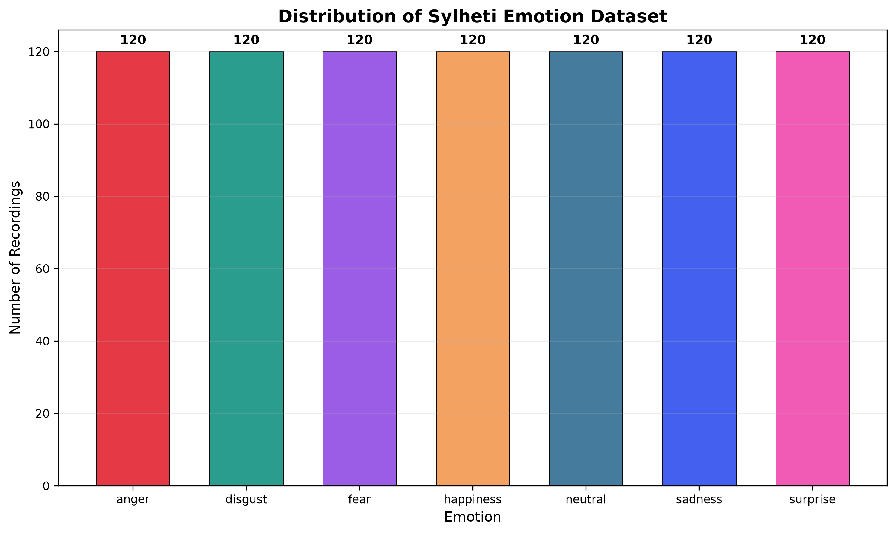

*Figure 1. Distribution of the seven emotion classes.*

---

## 3. Project Workflow

The complete processing pipeline follows this sequence:

```text
Raw Audio Dataset (840 recordings)
              |
              v
     Filename Validation
              |
              v
      Metadata Creation
              |
              v
       Audio Conversion
              |
              v
        WAV Verification
              |
              v
    Duration & Silence Analysis
              |
              v
      Speech Segmentation
              |
              v
   Acoustic Feature Extraction
              |
              v
       Feature Validation
              |
              v
    Dataset Balance Validation
              |
              v
       Data Visualization
              |
              v
      LOSO Model Training
              |
              v
       Model Evaluation
```

---

## 4. Data Processing Pipeline

### Step 1: Filename Validation and Metadata Creation

**Script:** `src/build_metadata.py`

- Validated recording filenames and naming conventions.
- Checked speaker IDs, gender, emotion labels, sentence IDs, and take numbers.
- Checked duplicate filenames and inconsistent metadata.
- Generated the metadata file.

**Output:** `dataset/metadata.csv`

**Result:** 840 valid recordings, zero invalid filenames.

### Step 2: Audio Conversion

**Script:** `src/convert_audio.py`

Original recordings were available in different formats, including M4A, MP4, and MP3.

All recordings were converted into a standardized format:

- WAV
- Mono channel
- 16 kHz sample rate
- 16-bit PCM

**Output:** `dataset/processed/`

**Result:** 840/840 recordings successfully converted.

### Step 3: Audio Verification

**Script:** `src/verify_audio.py`

Verified the converted recordings to ensure:

- Correct WAV format.
- Correct sample rate.
- Mono audio channel.
- 16-bit PCM encoding.
- No missing or unexpected WAV files.

**Result:** 840 recordings verified successfully.

### Step 4: Duration and Silence Analysis

**Scripts:**
- `src/analyze_duration_silence.py`
- `src/analyze_silence_types.py`

Analyzed audio duration and different types of silence:

- Leading silence
- Internal silence
- Trailing silence

This analysis helped understand the recording characteristics before speech segmentation.

### Step 5: Speech Segmentation

**Script:** `src/segment_speech_energy.py`

Used an energy-based segmentation approach to identify speech regions and reduce unnecessary silence.

The segmentation process uses short-time RMS energy, a noise-floor-based threshold, and padding to reduce the risk of cutting speech at the beginning or end.

**Output:** `dataset/speech_only/`

**Result:** 840/840 recordings successfully segmented.

### Step 6: Acoustic Feature Extraction

**Script:** `src/extract_acoustic_features.py`

Extracted 34 numerical acoustic features from the segmented speech recordings.

| Feature Group | Features |
|---|---:|
| MFCC Mean and Standard Deviation | 26 |
| Pitch Mean and Standard Deviation | 2 |
| RMS Energy Mean and Standard Deviation | 2 |
| Zero Crossing Rate Mean and Standard Deviation | 2 |
| Spectral Centroid Mean and Standard Deviation | 2 |
| **Total** | **34** |

Librosa was used for acoustic feature extraction.

**Output:** `dataset/features/speech_only_acoustic_features.csv`

**Result:**
- 840 recordings processed.
- 34 acoustic features extracted per recording.
- 840 rows and 40 columns, including six metadata columns.
- Zero extraction failures.

### Step 7: Feature Validation

**Script:** `src/validate_features.py`

Validated the extracted feature dataset for:

- Missing values
- Infinite values
- Duplicate rows and filenames
- Constant features
- Unexpected labels and speakers
- Numerical feature consistency

**Result:** All feature validation checks passed.

### Step 8: Dataset Balance Validation

**Script:** `src/validate_dataset_balance.py`

Verified the dataset distribution across speakers, emotions, gender, sentences, and takes.

**Result: 8/8 validation checks passed.**

The dataset contains:

- 210 recordings per speaker.
- 120 recordings per emotion.
- 30 recordings per speaker-emotion combination.
- 10 unique sentences per speaker-emotion combination.
- 3 takes per sentence.

### Step 9: Dataset Visualization

**Script:** `src/visualize_dataset.py`

Generated visualizations to explore the distribution and acoustic characteristics of the dataset.

Main visualizations:

#### Emotion Distribution


#### Acoustic Feature Distribution

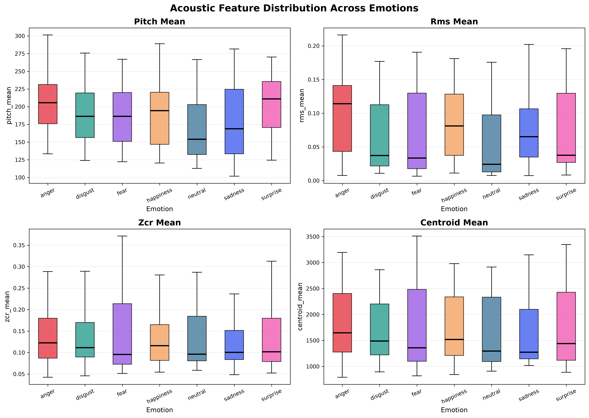

#### MFCC Emotion Heatmap

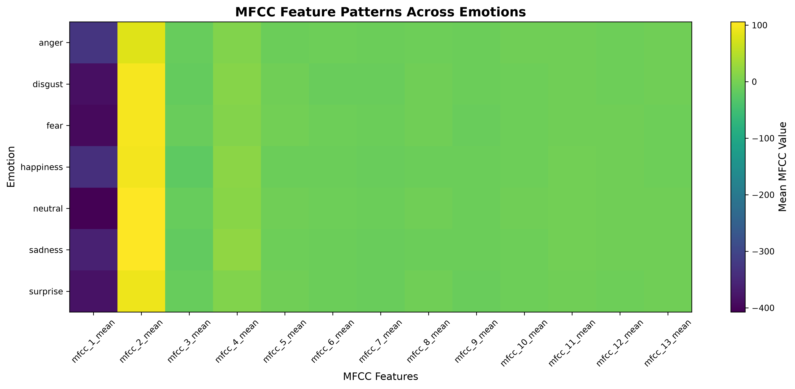

#### Emotion Feature Profile

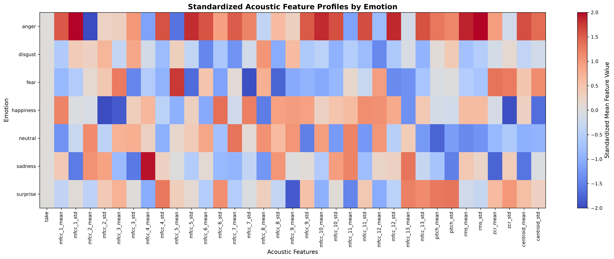

#### PCA Visualization

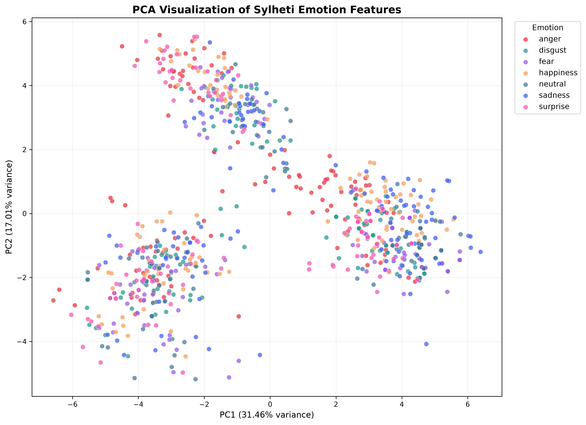

The first two principal components explain approximately **49.89%** of the total feature variance.

#### Acoustic Feature Comparison

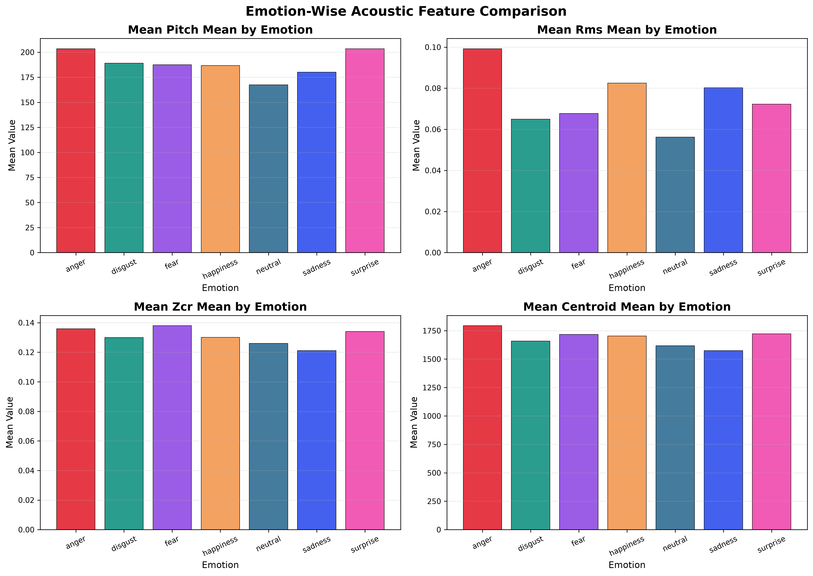

These visualizations provide an initial understanding of acoustic patterns and potential overlap between emotion categories.

---

## 5. Baseline Model Training

**Script:** `src/train_loso_baseline.py`

After completing data preparation and validation, preliminary machine learning experiments were conducted.

### Evaluation Strategy: Leave-One-Speaker-Out (LOSO)

Instead of using a random train-test split, we adopted a four-fold Leave-One-Speaker-Out evaluation strategy.

This approach evaluates whether a model can recognize emotions from a speaker whose recordings were not included in training.

| Fold | Training Speakers | Test Speaker |
|---|---|---|
| 1 | Fariba, Wasima, Joy | Arfat |
| 2 | Wasima, Arfat, Joy | Fariba |
| 3 | Fariba, Wasima, Arfat | Joy |
| 4 | Fariba, Arfat, Joy | Wasima |

Each fold contains:

- Training set: 630 recordings.
- Testing set: 210 recordings.

The held-out speaker is completely excluded from the corresponding training fold.

### Models Evaluated

**1. Support Vector Machine (SVM)**

- RBF kernel
- C = 1
- Gamma = scale
- StandardScaler

**2. Random Forest**

- 300 estimators
- Random state = 42
- Balanced class weights

**3. Dummy Baselines**

- Dummy Uniform
- Dummy Most Frequent

Dummy classifiers were included to provide reference performance for comparison.

### Model Input

Only the 34 numerical acoustic features were used as model inputs.

Metadata columns, including filename, emotion, speaker ID, gender, sentence ID, and take number, were excluded from the input features.

The emotion column was used as the target label.

### Evaluation Metrics

- Accuracy
- Macro-F1 (primary metric)
- Weighted-F1
- Precision
- Recall
- Confusion Matrix

Feature scaling was fitted only on the training data within each fold to avoid test-data leakage.

---

## 6. Baseline Evaluation Results

### Overall Results

| Model | Accuracy (Mean ± SD) | Macro-F1 (Mean ± SD) |
|---|---:|---:|
| SVM | 0.1762 ± 0.0447 | 0.1180 ± 0.0459 |
| Random Forest | 0.1667 ± 0.0421 | 0.0914 ± 0.0505 |
| Dummy Uniform | 0.1333 | 0.1326 |
| Dummy Most Frequent | 0.1429 | 0.0357 |

### Overall Macro-F1 Comparison

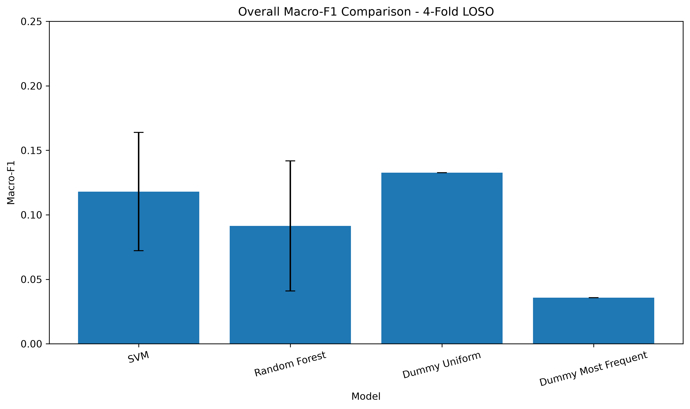

### Speaker-wise Performance

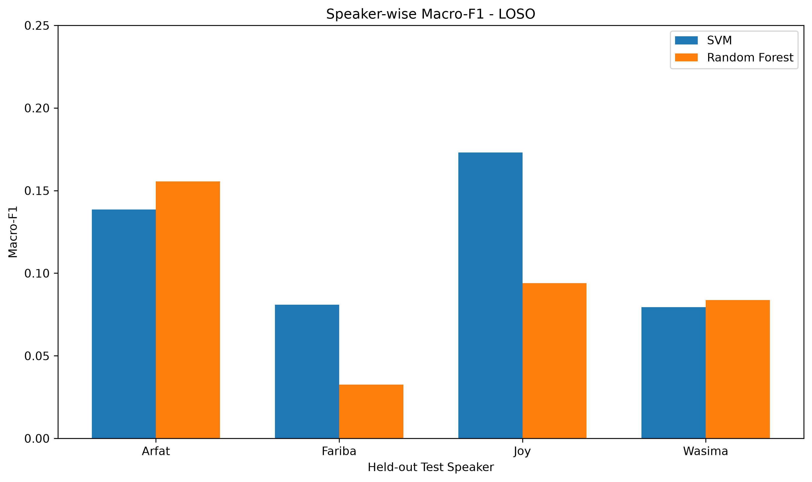

### Accuracy vs Macro-F1

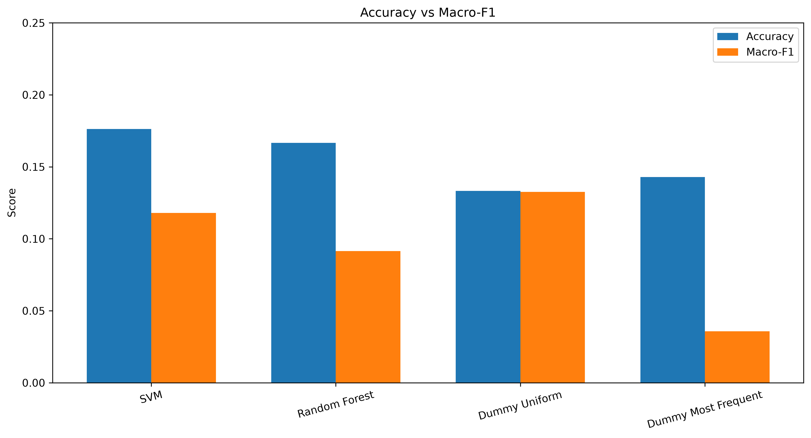

### SVM Confusion Matrix

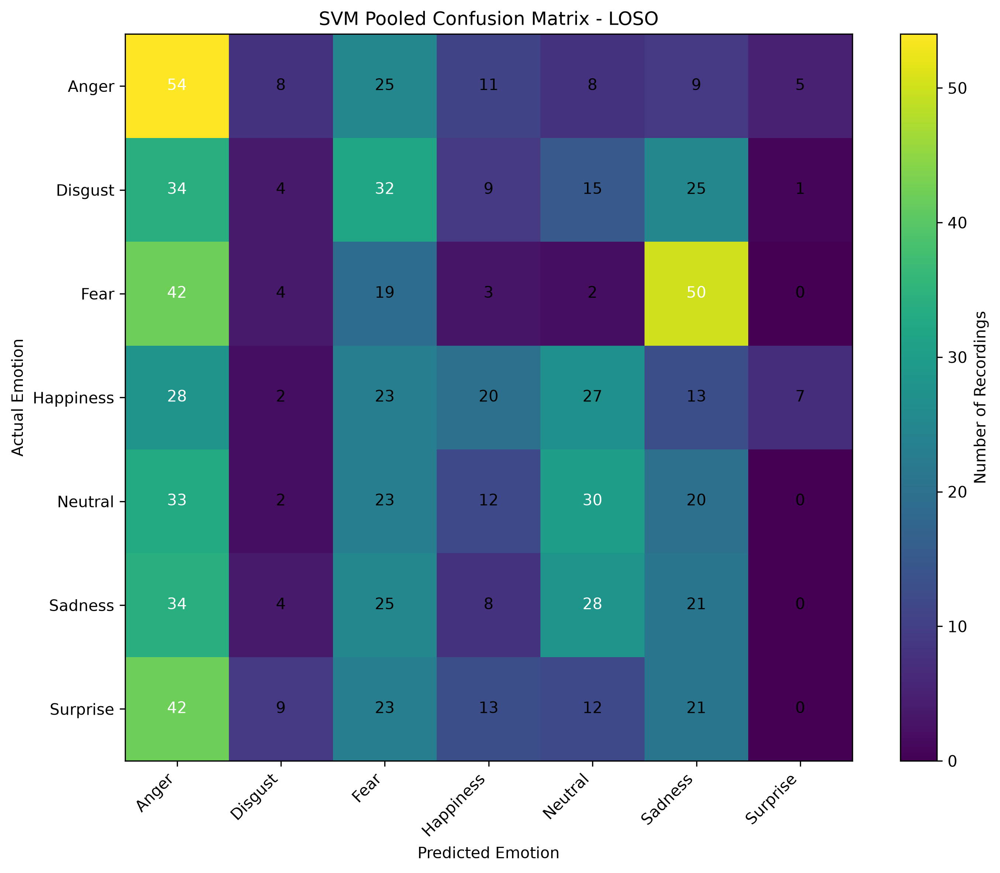

### Normalized Confusion Matrix

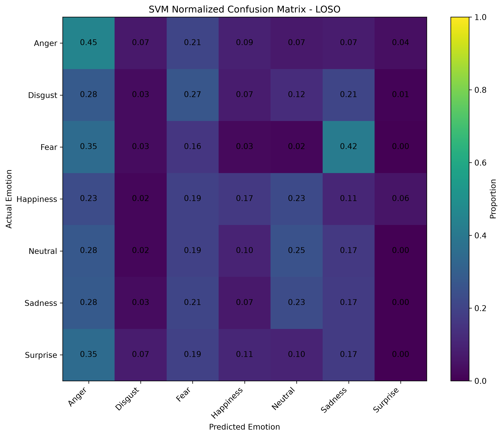

### Emotion-wise F1 Comparison

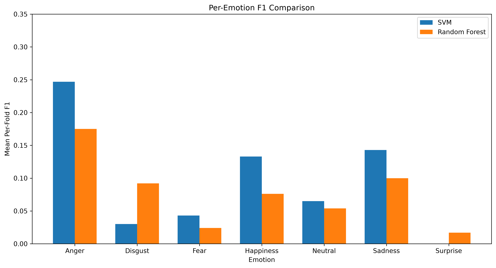

*Note: Emotion-wise F1 values represent the mean of the per-fold class-wise F1 scores, not pooled class-wise F1 scores.*

### Gender-wise Exploratory Comparison

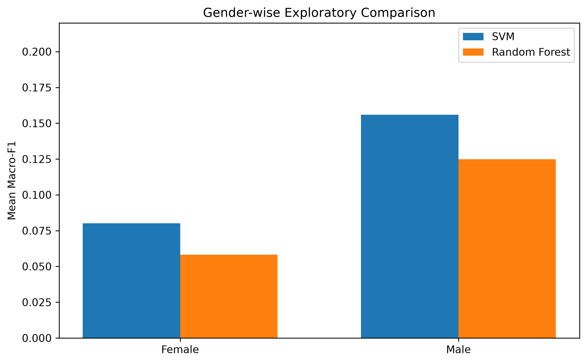

*Note: Gender-wise results are exploratory only, based on two speakers per gender. They should not be interpreted as evidence of general gender-related performance differences.*

---

## 7. Result Analysis

The preliminary LOSO evaluation shows that:

- SVM achieved an average accuracy of 17.62%.
- Random Forest achieved an average accuracy of 16.67%.
- SVM achieved a Macro-F1 of 0.1180.
- Random Forest achieved a Macro-F1 of 0.0914.
- Both trained models achieved lower Macro-F1 scores than the Dummy Uniform baseline.

The confusion matrix also shows considerable overlap between several emotion categories.

Some notable observations include:

- Disgust is frequently confused with Anger and Fear.
- Fear is frequently confused with Sadness.
- Surprise is particularly difficult for the current SVM baseline to identify.

These results indicate that the current acoustic feature representation and baseline models are not yet sufficient for reliable speaker-independent emotion recognition.

Rather than treating this as a successful final model, we consider it an important preliminary research finding that identifies areas requiring further investigation.

---

## 8. Current Project Structure

```text
Sylheti_Paralanguage_VA/
│
├── dataset/
│   ├── raw/
│   ├── processed/
│   ├── speech_only/
│   ├── features/
│   │   ├── plots/
│   │   ├── pitch_validation/
│   │   ├── audio_quality/
│   │   ├── model_results/
│   │   │   └── LOSO/
│   │   │       └── visualizations/
│   │   └── speech_only_acoustic_features.csv
│   ├── old_generated_data/
│   └── metadata.csv
│
├── src/
│   ├── build_metadata.py
│   ├── validate_audio.py
│   ├── inspect_audio.py
│   ├── convert_audio.py
│   ├── verify_audio.py
│   ├── analyze_duration_silence.py
│   ├── analyze_silence_types.py
│   ├── extract_acoustic_features.py
│   ├── validate_features.py
│   ├── visualize_features.py
│   ├── visualize_dataset.py
│   ├── segment_speech.py
│   ├── segment_speech_energy.py
│   ├── validate_pitch_quality.py
│   ├── compare_yin_pyin_fair.py
│   ├── plot_pitch_diagnostics.py
│   ├── detect_clipping.py
│   ├── analyze_background_noise.py
│   ├── extract_noise_review_clips.py
│   ├── validate_dataset_balance.py
│   ├── train_loso_baseline.py
│   └── visualize_loso_results.py
│
└── README.md
```

---

## 9. Technologies Used

- **Programming Language:** Python
- **Audio Processing:** FFmpeg, Librosa
- **Data Processing:** NumPy, Pandas
- **Machine Learning:** Scikit-learn
- **Visualization:** Matplotlib
- **Development and Version Control:** Git, GitHub

---

## 10. Current Progress and Next Steps

### Completed

- [x] Collection and organization of 840 recordings.
- [x] Filename validation and metadata generation.
- [x] Audio conversion to standardized WAV format.
- [x] WAV verification.
- [x] Duration and silence analysis.
- [x] Energy-based speech segmentation.
- [x] Extraction of 34 acoustic features.
- [x] Feature validation.
- [x] Dataset balance validation.
- [x] Dataset visualization.
- [x] Four-fold speaker-independent LOSO evaluation.
- [x] SVM and Random Forest baseline comparison.
- [x] Dummy baseline comparison.
- [x] Confusion matrix analysis.
- [x] Preliminary result visualization.

### Future Work

- Investigate the reasons behind emotion-wise classification errors.
- Explore improved acoustic feature representations.
- Evaluate additional machine learning approaches.
- Investigate speaker-related variability.
- Expand the dataset with more speakers and recordings.
- Conduct further speaker-independent evaluation.
- Develop an emotion-aware Sylheti virtual assistant.

---

## 11. Overall Summary

The current phase of the Sylheti Paralanguage-Aware Virtual Assistant project has established a complete preliminary data processing and baseline evaluation pipeline using 840 recordings from four speakers across seven emotion categories.

All recordings were standardized, verified, segmented, and transformed into 34 numerical acoustic features. The extracted dataset passed feature integrity and balance validation checks.

A four-fold Leave-One-Speaker-Out evaluation was then conducted using SVM, Random Forest, and Dummy baseline classifiers. The preliminary results reveal that speaker-independent emotion recognition remains challenging with the current feature representation and baseline models.

This work establishes a reproducible starting point for further research into Sylheti speech emotion recognition and paralanguage-aware virtual assistants.

---

**Project Status:** Preliminary dataset processing and baseline evaluation completed. Further model development and experimentation are ongoing.

